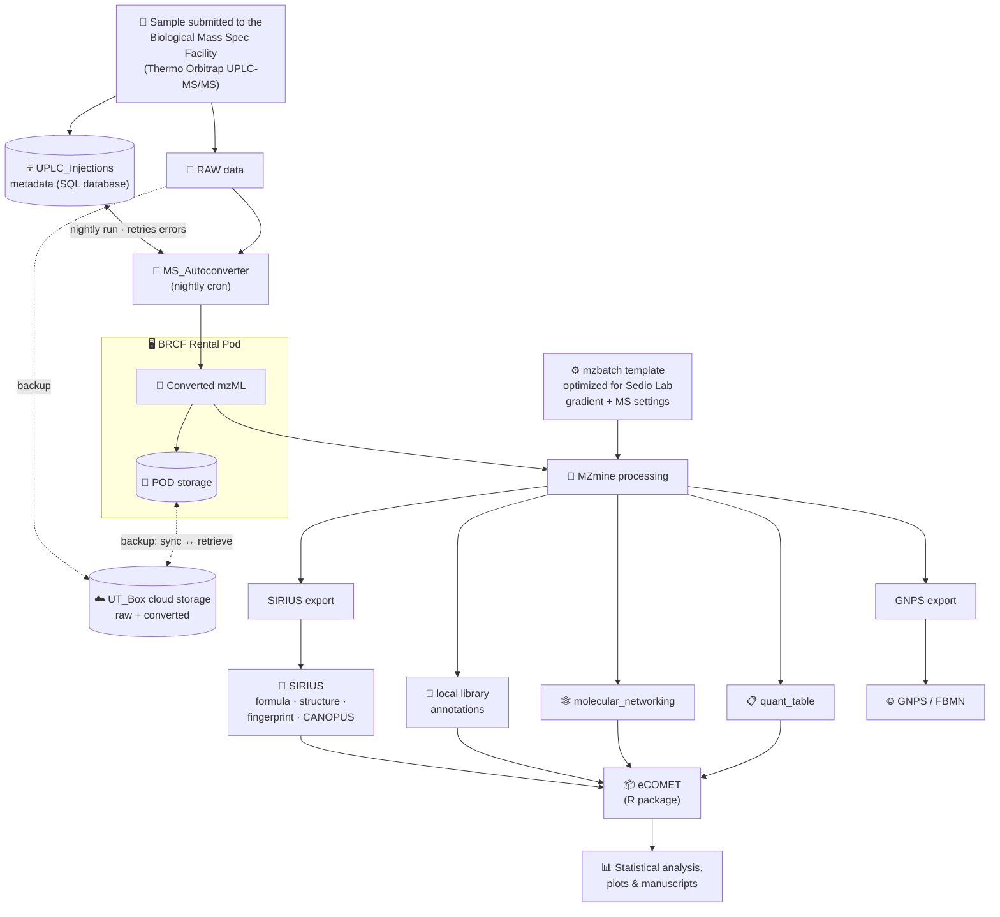

# UT Metabolomics Pipeline

**Author: [Dale Forrister](https://dale-forrister.github.io/)** · [website](https://dale-forrister.github.io/) · [GitHub](https://github.com/dale-forrister) — postdoctoral researcher, Sedio Lab, UT Austin

This repository is how the **[Sedio Lab](https://briansedio.weebly.com/)**
(UT Austin) processes untargeted LC-MS/MS metabolomics data. You start with a sheet listing your
samples; the pipeline converts the raw instrument files, detects and groups features across all
samples, builds molecular networks, and annotates the features with **SIRIUS** (and, optionally,
**DreaMS** spectral embeddings).

It is a set of **documented steps you run yourself** — not a black box. Each step is one command,
and the [`docs/`](docs/) walkthroughs explain both *how* to run it and *why* the parameters are set
the way they are. New here? Start with **[Getting Started](docs/getting_started.md)**, then follow
Parts 1→5 in order.

### Built on two UT Austin core facilities

- **[Biological Mass Spectrometry Facility](https://research.utexas.edu/cbrs/facilities/)**
  (UT CBRS; RRID:SCR_021728) — samples are run here on a high-resolution **Thermo Orbitrap**
  UPLC-MS/MS. The pipeline is **optimized for Orbitrap data**: high-resolution centroided spectra,
  and SIRIUS runs with its `orbitrap` instrument profile.
- **[Biomedical Research Computing Facility (BRCF)](https://research.utexas.edu/cbrs/facilities/brcf)**
  — all processing runs on its shared "POD" cluster
  ([users wiki](https://cloud.wikis.utexas.edu/wiki/spaces/RCTFusers)).

## How it works



> **Two different MGF exports** come out of MZmine and feed different tools — this trips people up:
> **SIRIUS** uses `*_sirius.mgf` (the *SIRIUS export*: the full per-feature MS1 isotope pattern + its
> MS2 scans, so SIRIUS sees all the fragmentation data). The *GNPS export* `*_iimn_gnps.mgf` (one
> merged consensus spectrum per feature) is what goes to **GNPS/FBMN** and to **DreaMS** embeddings.

## Pipeline at a glance

| Step | Tool (version) | Script in this repo | Output |
|---|---|---|---|
| 1. Metadata & setup | sample sheet (`.tsv`/`.csv`) + `check_metadata.py` | `code/mzmine_processing/check_metadata.py` | validated sample list |
| 2. Convert RAW → mzML | **MSConvert** (ProteoWizard `pwiz` Docker) | `ms_auto_converter` (auto) / `msconvert-batch.py` (manual) | MS-only (or +UV) `.mzML` |
| 3a. Build MZmine batch | batch updater (fills the template from your metadata) | `code/mzmine_processing/update_mzmine_batch.py` | run-ready `.mzbatch` |
| 3b. Feature finding + networking | **MZmine 4.10.90** | `resources/mzbatch/` template | quant table, compound groups, GNPS & SIRIUS MGFs, FBMN/IIMN graphs |
| 4. Structural annotation | **SIRIUS 6.5.4** (CSI:FingerID, CANOPUS) | `code/sirius_batch_processing/` | formula, structure, fingerprint, compound-class tables |
| 4. Spectral embeddings (optional) | **DreaMS** (PyTorch) | see [Part 4](docs/metabolomics_pipeline_part_4.md) | per-feature embeddings |
| 5. SIRIUS at scale | chunked, resumable runner | `code/sirius_batch_processing/` | the Part-4 tables, for large projects |

Also uses: **rclone** (UT_Box transfers), **Python 3** + pandas. Everything is pre-installed on POD
under `/stor/work/Sedio/software` and `/stor/work/Sedio/conda_envs` — you do not install anything.

## What you provide: the sample sheet

A `.tsv` or `.csv` with **one row per injection**. Required columns (checked by `check_metadata.py`):

| Column | Required? | Meaning |
|---|---|---|
| `Sample_Type` | **yes** | one of `Sample` / `Blank` / `Standard` (≥ 1 `Blank` is needed for blank subtraction) |
| `Full_path` | **yes** | absolute path to the converted `.mzML` for that injection |
| anything else | optional | species, treatment, traits… — carried through into the results |

(If your files aren't listed by full path, `check_metadata.py --resolve-dir <dir>` can locate them by
filename instead.)

## The main pieces

- **MSConvert / ms_auto_converter** — a cron job
  ([ms_auto_converter](https://github.com/dale-forrister/ms_auto_converter)) converts new instrument
  files automatically each night and syncs them to Box. When you need to convert your own data, or
  the auto-converter is down, run it manually from a CSV. Both paths, and the three conversion
  presets, are documented in **[Part 2](docs/metabolomics_pipeline_part_2.md)**.
- **MZmine batch updater** (`update_mzmine_batch.py`) — you don't hand-edit MZmine batch files. The
  updater takes your metadata sheet and fills the sample list, blank-subtraction groups, and output
  names into a **batch template**, producing a run-ready `.mzbatch`.
- **Default batch template** (`resources/mzbatch/`) — a versioned MZmine template whose parameters
  are tuned for the **lab's standard extraction and UPLC-MS protocol** (gradient + Orbitrap
  settings). It is the default, but you can point the updater at an **alternate template**
  (`--mzbatch <your_template>`) for a different method.
- **MS2Deepscore & DreaMS networking** — these run **inside the MZmine batch** as molecular-networking
  steps for normal-sized projects. For very large projects they can be computed **separately on a
  GPU** (they are the memory-heaviest steps) and merged back in.
- **SIRIUS at scale** (`code/sirius_batch_processing/`) — splits the SIRIUS MGF into chunks and runs
  them resumably, for projects too large to do in one pass.

## Quickstart

> Condensed path for someone with a POD account and a sample sheet. Full detail in [`docs/`](docs/).

```bash
PY=/stor/work/Sedio/conda_envs/mzmine_processing/bin/python
MZMINE=/stor/work/Sedio/software/mzmine_41090/bin/mzmine

# 1. Validate the sample sheet (checks Sample_Type, Full_path, blanks, that every file exists)
$PY code/mzmine_processing/check_metadata.py my_samples.tsv

# 2. Build a run-ready MZmine batch from the metadata + the default template
$PY code/mzmine_processing/update_mzmine_batch.py \
    --mzbatch    resources/mzbatch/r12_networking_libV3.mzbatch \
    --metadata   my_samples.tsv \
    --output_dir my_project/mzmine_out \
    --project_name MyProject \
    --path_col   Full_path \
    --library    /path/to/UT_Austin_in_house_V3_mixRT.json      # see resources/libraries/README.md

# 3. Run MZmine (one project at a time — see the warning below)
_JAVA_OPTIONS=-Xmx48G $MZMINE -b my_project/mzmine_out/MyProject.mzbatch -user <you>.mzuser

# 4. SIRIUS on the *_sirius.mgf  (see docs/metabolomics_pipeline_part_5.md)
$PY code/sirius_batch_processing/split_mgf_randomized.py -i my_project/mzmine_out/MyProject_sirius.mgf ...
bash   code/sirius_batch_processing/run_sirius_batches.sh ...
```

> ⚠️ **Run heavy steps one at a time.** MZmine and SIRIUS memory-map large data; several concurrent
> `-Xmx48G` jobs will exhaust the node's memory. Process projects sequentially.

## Documentation

| Guide | Covers |
|---|---|
| [Getting Started](docs/getting_started.md) | account, login, first connection, storage |
| [Part 1 — Metadata & UPLC setup](docs/metabolomics_pipeline_part_1.md) | the sample sheet, run layout |
| [Part 2 — RAW → mzML (MSConvert)](docs/metabolomics_pipeline_part_2.md) | auto-converter, manual CSV, the 3 presets |
| [Part 3 — MZmine processing](docs/metabolomics_pipeline_part_3.md) | feature finding, networking, exports |
| [Part 4 — SIRIUS & DreaMS](docs/metabolomics_pipeline_part_4.md) | structural annotation, embeddings |
| [Part 5 — SIRIUS at scale](docs/metabolomics_pipeline_part_5.md) | chunked, resumable batch runs |
| [Overview of Resources](docs/overview_of_resources.md) | POD storage, conda, rclone, cheat-sheets |

## Repository layout

```
UT_Metabolomics_Pipeline/
├── README.md
├── code/
│   ├── mzmine_processing/         ← check_metadata.py, update_mzmine_batch.py
│   ├── sirius_batch_processing/   ← split → run → merge SIRIUS at scale
│   └── Example_UV_VIS_extraction.R
├── resources/
│   ├── mzbatch/                   ← versioned MZmine batch template(s)
│   └── libraries/                 ← spectral libraries (on POD, not in git — see its README)
└── docs/                          ← the numbered walkthroughs above
```

## Roadmap

Working today (run step-by-step as documented):

- ✔ Conversion — automatic daily converter **and** manual CSV
- ✔ Metadata validation + MZmine batch generation from a sample sheet
- ✔ MZmine feature finding, grouping, and molecular networking (cosine, MS2Deepscore, DreaMS)
- ✔ SIRIUS annotation, including resumable at-scale batch processing
- ✔ DreaMS spectral embeddings

Planned:

- ◻ **Snakemake** wrapper — one command from sample sheet to results, with memory-aware scheduling
- ◻ Small demo dataset + a CI `--dry-run` check
- ◻ Downstream **eCOMET** (R) handoff for statistics, plots, and figures

## Acknowledgments & citation

Developed by **Dale Forrister** (Sedio Lab, UT Austin). This work relies on two UT Austin core
facilities — the **Biological Mass Spectrometry Facility** (RRID:SCR_021728) and the **Biomedical
Research Computing Facility (BRCF)**; please acknowledge them (and the facility RRID) in publications
that use this pipeline. Built on the open-source [MZmine](https://mzio.io/),
[SIRIUS](https://bio.informatik.uni-jena.de/software/sirius/), and
[DreaMS](https://github.com/pluskal-lab/DreaMS) projects — please cite those tools as well.
