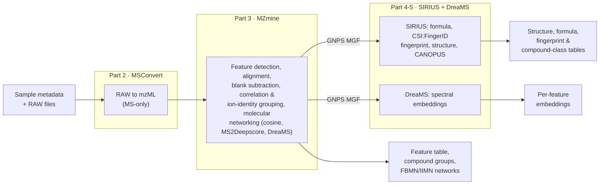

# UT Metabolomics Pipeline

**A reproducible, metadata-driven workflow for untargeted LC-MS/MS metabolomics** — from raw
instrument files to annotated features, molecular networks, and spectral embeddings.

Built and run in the **Sedio Lab** (UT Austin) on the BRCF POD cluster. The pipeline takes a single
**sample metadata sheet** and carries a project end to end: convert → feature detection →
molecular networking → structural annotation → machine-learning embeddings.

> **Status:** actively used in production (6 student projects processed start-to-finish, Nov 2026).
> A Snakemake workflow wrapping these steps is in progress — see [Roadmap](#roadmap).

---

## What it does



| Step | Tool | What it produces |
|---|---|---|
| **1. Metadata & setup** | sample sheet (`.tsv`/`.csv`) | validated run manifest (one row per injection) |
| **2. Convert** | MSConvert | MS-only `.mzML` |
| **3. Feature finding + networking** | MZmine 4.10.90 | aligned feature table, compound groups, GNPS MGF, FBMN/IIMN graphs |
| **4. Structural annotation** | SIRIUS 6.5.4 (CSI:FingerID, CANOPUS) | formulas, structures, fingerprints, compound classes |
| **4. Spectral embeddings** | DreaMS | per-feature learned embeddings |
| **5. SIRIUS at scale** | chunked batch runner | the above, for large projects, resumably |

---

## Quickstart

> Full, step-by-step instructions live in [`docs/`](#documentation). This is the condensed path
> for someone who already has a POD account and a metadata sheet. New here? Start with
> **[Getting Started](docs/getting_started.md)**.

```bash
# 0. Tools (no install needed — shared conda envs on POD)
PY=/stor/work/Sedio/conda_envs/mzmine_processing/bin/python
MZMINE=/stor/work/Sedio/software/mzmine_41090/bin/mzmine

# 1. Validate your metadata sheet (checks required columns, Sample_Type, blanks, that every file exists)
$PY code/mzmine_processing/check_metadata.py my_project_metadata.tsv

# 2. Build a run-ready MZmine batch from the metadata + the versioned template
$PY code/mzmine_processing/update_mzmine_batch.py \
    --mzbatch    resources/mzbatch/r12_networking_libV3.mzbatch \
    --metadata   my_project_metadata.tsv \
    --output_dir my_project/mzmine_out \
    --project_name MyProject \
    --path_col    Full_path \
    --library    /path/to/UT_Austin_in_house_V3_mixRT.json   # see resources/libraries/README.md

# 3. Run MZmine (heap sized to the node; one project at a time)
_JAVA_OPTIONS=-Xmx48G $MZMINE -b my_project/mzmine_out/MyProject.mzbatch -user <you>.mzuser

# 4. SIRIUS at scale on the exported MGF  (see docs/metabolomics_pipeline_part_5.md)
$PY code/sirius_batch_processing/split_mgf_randomized.py -i my_project/mzmine_out/MyProject_sirius.mgf ...
bash   code/sirius_batch_processing/run_sirius_batches.sh ...
```

> ⚠️ **Run heavy steps one at a time.** MZmine and SIRIUS memory-map large data; several concurrent
> `-Xmx48G` jobs will exhaust the node's virtual-memory cap. Process projects sequentially (the
> upcoming Snakemake workflow will enforce this automatically).

---

## Documentation

The numbered guides walk through the whole workflow with copy-paste commands:

| Guide | Covers |
|---|---|
| [Getting Started](docs/getting_started.md) | account, login, first connection, storage |
| [Part 1 — Metadata & UPLC setup](docs/metabolomics_pipeline_part_1.md) | sample metadata, run layout |
| [Part 2 — RAW → mzML (MSConvert)](docs/metabolomics_pipeline_part_2.md) | pull from UT_Box, convert MS-only |
| [Part 3 — MZmine processing](docs/metabolomics_pipeline_part_3.md) | feature finding, networking, exports |
| [Part 4 — SIRIUS & DreaMS](docs/metabolomics_pipeline_part_4.md) | structural annotation, embeddings |
| [Part 5 — SIRIUS at scale](docs/metabolomics_pipeline_part_5.md) | chunked, resumable batch runs |
| [Overview of Resources](docs/overview_of_resources.md) | POD storage, conda, rclone, cheat-sheets |

---

## Repository layout

```
UT_Metabolomics_Pipeline/
├── README.md                      ← you are here
├── code/
│   ├── mzmine_processing/         ← metadata validation + batch builder
│   │   ├── check_metadata.py
│   │   └── update_mzmine_batch.py
│   ├── sirius_batch_processing/   ← split → run → merge SIRIUS at scale
│   └── Example_UV_VIS_extraction.R
├── resources/
│   ├── mzbatch/                   ← versioned MZmine batch template(s)
│   └── libraries/                 ← spectral libraries (on POD, not in git — see its README)
└── docs/                          ← the numbered walkthroughs above
```

---

## Requirements

Everything is pre-installed on POD under `/stor/work/Sedio/software` and `/stor/work/Sedio/conda_envs`:

- **MZmine 4.10.90** (headless batch mode; needs a user token — see Part 3)
- **SIRIUS 6.5.4** (CSI:FingerID + CANOPUS require a free academic login)
- **DreaMS** (`conda env` with PyTorch)
- **MSConvert** (containerized), **rclone** (UT_Box transfers), Python 3 + pandas

---

## Roadmap

- [x] Metadata-driven MZmine batch builder + validator
- [x] Resumable, chunked SIRIUS batch processing
- [ ] **Snakemake workflow** — `config.yaml` + `samples.tsv`, per-rule conda envs, `--dag` diagram, one-command run with memory-aware scheduling
- [ ] Tiny demo dataset + GitHub Actions `--dry-run` CI
- [ ] DreaMS embedding + eCOMET (R) handoff as workflow rules

---

## Author & acknowledgments

Developed by **Dale Forrister** (Sedio Lab, UT Austin). Runs on the UT Austin BRCF POD cluster
(RCTF). Built on the open-source [MZmine](https://mzio.io/), [SIRIUS](https://bio.informatik.uni-jena.de/software/sirius/),
and [DreaMS](https://github.com/pluskal-lab/DreaMS) projects — please cite those tools when you use this pipeline.
